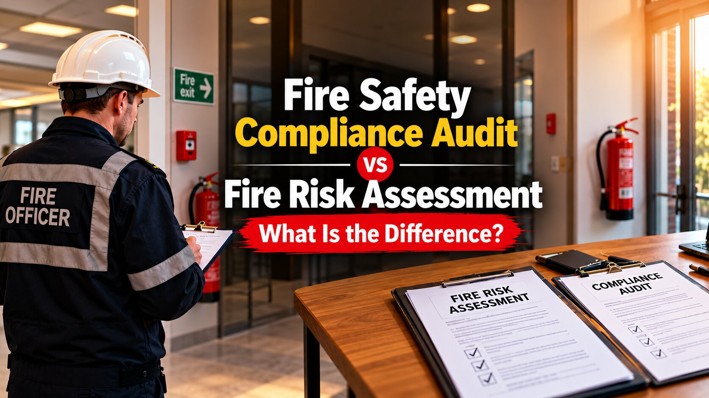
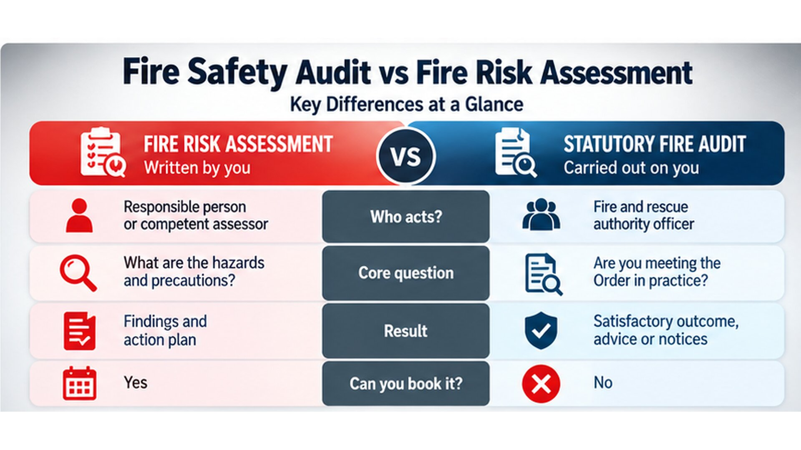
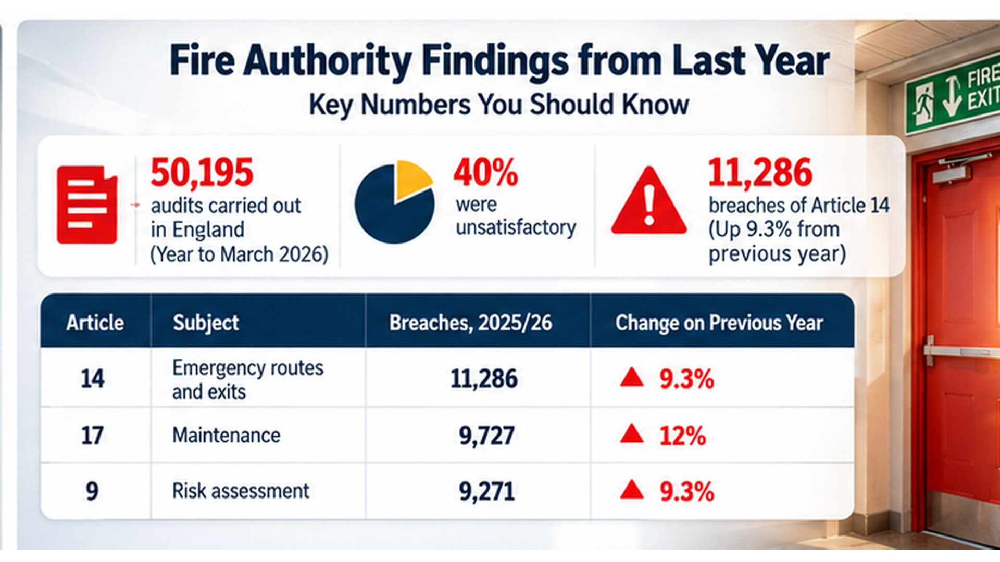

Consider, for instance, the scenario where a fire officer comes into your premises and requests that you provide him with an essential document that you have produced. The document can be of great significance in how things will proceed. It is in such an instance that a crucial distinction is made between a fire safety audit and a fire risk assessment. Though the two concepts might seem to mean the same thing, they do not.

## The Document You Have Prepared and the Visit You Cannot Plan

To understand the issues of fire safety compliance, you need first of all to familiarise yourself with this important document. In accordance with Article 9 of the Regulatory Reform (Fire Safety) Order 2005, the fire risk assessment shall be performed by the responsible person, who can be any of the following individuals: the owner of the property, a landlord, an employer or any other person having such control over the premises. This article covers the [fire risk assessment requirements](/services/fire-risk-assessment) related to England and Wales; other countries have their own legislation, which you should follow.

In accordance with the official site of the Government of the United Kingdom, there are five basic steps that need to be taken to perform a fire risk assessment properly: identification of hazards, people's vulnerability, evaluation of fire safety measures taken by the business, documenting the results and reviewing these documents regularly. Since 1st October 2023, all businesses are required to document their findings, whatever the size of the company is.

<BlogCTA
  label="Get a Fire Risk Assessment"
  href="/services/fire-risk-assessment"
/>

The [Regulatory Reform (Fire Safety) Order 2005](https://www.legislation.gov.uk/uksi/2005/1541/article/9) says that the review shall be done regularly; once a year or less often is a rather popular practice, but no specific schedule is defined in the order. However, if any significant changes occur, a review may be required. Here you can get the help of a competent professional, but you, as the responsible person, remain fully responsible for performing it.

## Why Does the Word Audit Cause All This Fuss?

When a fire officer comes knocking and says they're here for a fire compliance audit, what they usually mean is a planned visit, part of a risk-based programme they're running. They're checking to see if your premises are meeting the requirements of the order. They'll be looking at your fire risk assessment, your fire logbook, training records, drill logs and all that kind of thing, so make sure you're keeping on top of those.

Some places might say they're doing a 'Business Safety Check' instead; Nottinghamshire does this, and they'll give your premises a rating. If you get a poor grade, you might get a follow-up visit for a full fire safety audit. But here's the catch: private consultants might use the term 'fire safety audit' in a different way too. These types of reviews can be useful, but they're a separate thing from the official process and can't replace a visit from the fire and rescue authority.

The term 'fire safety inspection' is pretty broad and covers a range of things too.

## Who Does What, a Quick and Dirty Guide?

The key to getting your head around the difference between a fire safety audit and a fire risk assessment is to work out who prepared the document and who's checking HMO fire safety compliance. Once you get that bit sorted, you'll have a better idea of what you're looking at.

| Point            | Fire Risk Assessment                     | Statutory Fire Audit                    |
| ---------------- | ---------------------------------------- | --------------------------------------- |
| Direction        | Written by you                           | Carried out on you                      |
| Who acts         | Responsible person or competent assessor | Fire and rescue authority officer       |
| Core question    | What are the hazards and precautions?    | Are you meeting the Order in practice?  |
| Result           | Findings and action plan                 | Satisfactory outcome, advice or notices |
| Can you book it? | Yes                                      | No                                      |

During the course of the audit, the officer will review your documentation as well as the conditions inside the building. As a consequence, an inadequate assessment can jeopardise the whole audit process. Even if the results are good, they only demonstrate the state of affairs at the time of the [fire alarm testing and inspection](/services/fire-alarm-testing), not the approval.

## Officer Findings from Last Year

A total of 50,195 audits were carried out by fire and rescue authorities in England in the year to March 2026, of which 40% were unsatisfactory. Issues related to emergency routes and escape routes were the most common breaches noted. A total of 11,286 breaches of Article 14 have been registered, representing a 9.3% increase from the previous year.

| Article | Subject                    | Breaches, 2025/26 | Change on Previous Year |
| ------- | -------------------------- | ----------------- | ----------------------- |
| 14      | Emergency routes and exits | 11,286            | Up 9.3%                 |
| 17      | Maintenance                | 9,727             | Up 12%                  |
| 9       | Risk assessment            | 9,271             | Up 9.3%                 |

These statistics reveal how many infringements were recorded but say nothing about their cause. They indicate places where violations were found but not the reasons why. Nevertheless, this trend points to three items that should be inspected on a regular basis: ensuring unobstructed escape routes, the proper functioning of fire protection systems and a current [fire risk assessment for HMOs](/services/fire-risk-assessment/hmo).

## The Road from Advice to Closure

A report with an "unsatisfactory" rating does not necessarily mean that a notice will be issued. The first step that can be taken is to provide guidance, send a deficiency letter or create an action plan. Nonetheless, if the violation is grave or cannot be corrected, GOV.UK describes three types of statutory notices.

| Notice                   | What It Does                                   | Issued, 2025/26 |
| ------------------------ | ---------------------------------------------- | --------------- |
| Enforcement (Article 30) | Lists breaches; at least 28 days to fix them   | 1,896           |
| Prohibition (Article 31) | Restricts or stops use of the premises         | 1,224           |
| Alterations (Article 29) | Requires notification before specified changes | 202             |

Prohibition notices increased by a whopping 27% in the year up to March 2026; that's the biggest jump of the three types. In fact, it's more than double the increase in enforcement notices, which rose by a relatively modest 6.9% over the same period.

[You've got 21 days to make an appeal to the magistrates court](https://www.gov.uk/government/publications/fire-safety-order-enforcement-and-sanctions-for-non-compliance/enforcement-and-sanctions-for-non-compliance-accessible), but the thing is, a prohibition notice typically stays in place right up till the appeal is heard, and if you're lucky enough to get a serious breach, an unlimited fine is the least of your worries, as you could even face a prison sentence of up to two years in the Crown Court.

## Shared Houses and the Two Regulator Problem

In England, sharing a place with three or more people from more than one household counts as a house in multiple occupation (HMO) where you've all got to share the kitchen, bathroom or the toilet. If the place has five or more tenants, then you need a special licence from the local council.

You might think, but actually, there are two people looking out for your safety in an HMO: the fire authority, making sure the fire safety order is being followed in all the shared areas, and the council looking after the housing standards. A fire risk assessment is going to focus on the stairs, corridors and shared spaces, not every single room in your own flat. Inspectors will still be able to come into your flat if that's what it takes to serve a prohibition notice, and councils might pile on extra fire risk assessment requirements, so to get your HMO fire safety right, you need to keep records that satisfy both of them.

Risk Assessment North, which is part of FireRisk.io, carries out HMO and residential fire risk assessments across Greater Manchester and Lancashire. Its assessors are BAFE SP205 qualified and its reports follow PAS 79.

## Building a Routine That Can Weather Any Surprise Visit

Getting your fire safety right is always going to work best if it's just part of your regular routine. You never know when the fire brigade will turn up; maybe it'll be in response to a complaint, a fire, or maybe they just popped by on a whim. If you can tell the difference between a fire safety audit and a fire risk assessment, that'll help you decide exactly where you need to get some professional help. Assessors can spot the hazards, but consultants can have a look at your management systems. Make sure you assign a clear task and deadline to every single thing in the assessment, and keep a record of who did it and when, like a receipt or a photo.

If you're going to do it right, you need to keep your fire alarms in check. That means doing a weekly check of the call points and getting a qualified engineer to service them periodically. And then there are the other things the government expects of you, like keeping escape routes clear and doing at least one fire drill a year, then putting the results on file.

Risk Assessment North provides fire alarm testing to the BS 5839-1:2017 standard, as well as testing your emergency lighting and fire doors. If you need a written report in a hurry, then they can do one within 24 hours, but that might cost a bit extra.

## The Question Hiding Behind Every Satisfactory Result

You might think that getting a pass on your fire safety inspection is the end of it all, but the truth is the fire officer has only seen your building on that one particular day. And then there's the assessment which can just end up on a shelf and gather dust unless someone is keeping an eye on it and updating it every time something changes.

<BlogCTAPair
  quoteLabel="Get a Quote"
  quoteHref="/contact"
  callLabel="Call: +44 161 987 1020"
  callHref="tel:+441619871020"
/>

## Frequently Asked Questions

### Could the Audit Be Conducted by A Private Company?

No, the enforcement authority, which is usually the local fire and rescue authority, conducts the audit. Private companies could conduct voluntary management reviews to help you prepare, but these are not linked to the audit process under the law.

### Would A Successful Audit Make My Assessment Valid Forever?

No. The audit would depend on the state the officer would observe and the documents reviewed on the day of the visit. The responsible person is supposed to review the assessment at least once a year.

### How Frequently Should A Fire Risk Assessment Be Reviewed?

It is mandatory to conduct reviews according to the law, and it could be done more frequently if the assessment is no longer valid. An annual review is the norm, whereas refurbishment or change of use will warrant an earlier review.

### Would A Small Business Need A Written Assessment?

Yes, all responsible persons covered under the order must record the assessment, whether there are few people working there or not. It may take a brief document to assess risks of smaller premises, but still, hazards, people at risk and measures taken to counter those risks should be identified.

### Who Is Responsible for A Shared Property?

The responsibility depends on which party controls each part of the building; it could be the freeholder, managing agent, landlord or tenant. These parties should coordinate with each other to make sure that all the parts, including staircases, plant rooms and corridors, are assessed.

### Can a Fire Safety Officer Enter Your Business Without Notice?

Yes. Fire safety officers have the legal authority to enter business premises at reasonable times to check compliance with fire safety regulations. Although inspections are often arranged in advance, officers may also visit without prior notice.

### Can Employees Be Questioned During a Fire Safety Audit?

Yes. Fire safety officers may speak with employees to check their understanding of emergency procedures, evacuation routes and fire safety training. Staff should know what to do if a fire occurs and how to report potential hazards.
