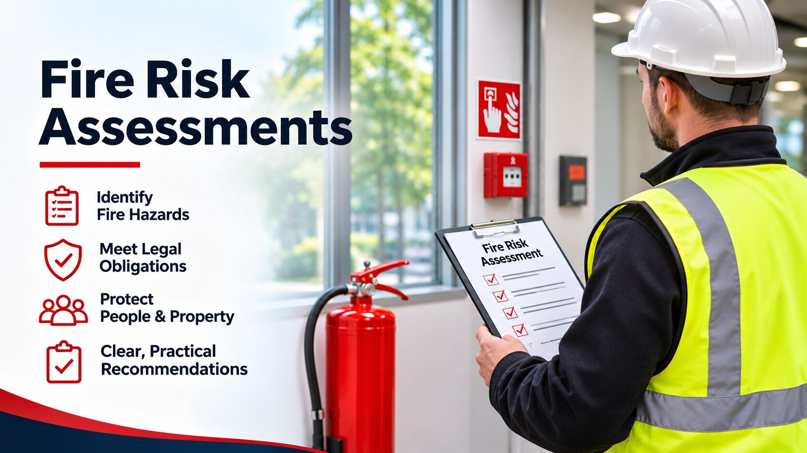

Bolton's fire risk is built into its architecture. The town ran on cotton for a century and the mills that made it are still standing, most of them now holding people rather than machinery.

Instructions reach us from across the borough. A landlord with one terrace house, an agent running twenty, an employer in a unit off the ring road, an owner-manager who has just taken on a building and wants to know what has been inherited along with the keys.

Nobody gets a template. We look at the building that is actually there, list what could burn, work out who would be in the way and set out what has to change first.

Whether you manage an office, retail shop, HMO, warehouse or converted mill, our assessments help identify potential fire hazards, evaluate existing safety measures and highlight improvements needed to protect people and property. Our BAFE SP205 registered assessment service provides clear recommendations, practical advice and written reports. Reports can be provided within 24 hours on request, subject to availability.

## The Borough's Inherited Stock

Spinning floors were designed around shafts and belts. Timber beams, cast iron columns, brick stair towers built to shift goods. When a mill becomes apartments or offices, that frame stays, and the partitions, locked doors and new services added since sit inside it.

The terraces around Halliwell, Daubhill and Great Lever carry the residential version of the same problem. Shared walls, steep stairs, cellars brought into habitable use, lofts converted and doors swapped over the years for whatever fitted.

Middlebrook and the industrial estates add a third pattern. Big floor plates, high fire loads, racking that has grown and staff who may never have been shown the assembly point.

## Fire Risk Assessment Bolton: What We Look At

The assessor walks the building rather than reading about it. Detection and warning come first, because a fire nobody hears about is a fire nobody escapes. Then the routes out, including the doors, stairs, lighting and the width of the corridor where it turns a corner.

Compartmentation gets checked against the drawings where drawings exist, and against common sense where they do not. Records come last, and they often say more about the building than the survey does.

The conclusion is a judgement about whether the precautions match the risk, not a list of defects.

## Common Findings in Bolton

Closers set so hard that staff wedge the door instead. A cable run punched through a compartment wall and never made good. Storage under the only staircase. A panel in fault that nobody has written down. Emergency lights that were tested at handover and not since.

In the older terraces the usual losses are the lobby door, the second stair and the original door. Each was removed for a good reason at the time and none of them was replaced.

## Why Fire Risk Assessments Matter in Bolton

The duty sits with the responsible person under the Fire Safety Order, which for most businesses means the employer or whoever controls the premises. Greater Manchester Fire and Rescue Service enforces it, and Bolton Council adds licensing conditions for HMOs.

Enforcement follows risk rather than postcode, but the borough gives inspectors plenty to look at. A mill conversion with a single stair or a warehouse with sleeping accommodation will always draw more attention than a modern office.

Insurers now ask for a current report before they will quote, and a claim is a poor moment to find out that the last one described a different layout.

## What Will Your Fire Risk Assessment Report Include?

Three readers matter. The person who has to act, the contractor who has to price the work and the inspector who may read it years from now.

The document sets out the premises, the scope, the hazards, who is exposed, how the existing precautions measure up, the significant findings, the actions in priority order and a date to review. Photographs go in where a picture settles an argument faster than a description.

Jargon is kept out. A finding nobody understands will not be fixed.

Your written report provides a record of the assessment and its findings. Depending on the building and the scope of the assessment, it may include:

- Details of the premises and their use.
- Identified fire hazards and people at risk.
- An evaluation of existing fire precautions.
- Areas requiring improvement.
- Recommended actions and priorities.
- Findings relating to emergency escape arrangements.
- Fire safety management recommendations.
- Information to support future assessment reviews.

## Fire Risk Assessment Bolton Cost

Smaller properties start at £249. Above that, the quote follows the building rather than a rate card.

- Floor area and storey count, because both add inspection time
- Use, since a mill, a terrace, a warehouse and an office fail in different ways
- Occupancy, as the number and type of people inside set the risk
- The condition of alarms, lighting and doors, which takes longer to verify when they are old
- Reporting depth, because a portfolio needs more detail than a single shop

Compare what is included, not just the total. A cheap quote that skips the compartmentation is a smaller job, not a better price.

We carry out fire risk assessments Bolton landlords, agents and employers can put in front of a licensing officer, an insurer or an inspector without a rewrite.

We provide clear, detailed fire risk assessment reports to help Bolton landlords, managing agents and employers demonstrate how fire safety risks have been assessed and addressed.

If you need a fire risk assessor Bolton landlords can book without a long lead time, send the property details and we will confirm availability. The same team works as a fire safety consultant Bolton employers call on before a change of use, and as a fire risk assessment Bolton managing agents can rely on across a portfolio.

For the wider picture, the [Risk Assessment North](/) homepage sets out the regional service, and our [Fire Risk Assessment Manchester](/fire-risk-assessments-manchester) page covers the city end of Greater Manchester. A small office may have different assessment requirements from a large warehouse, multi-storey residential building or converted industrial property.

When comparing prices, it is important to consider the scope of the inspection, the assessor's competence and the quality of the report. For an accurate fire risk assessment of Bolton costs, contact our team with your property details.

Choosing a suitable fire risk company in Bolton is an important decision for any property owner or responsible person. Risk Assessment North provides professional assessment services with an emphasis on identifying risks, explaining findings and recommending practical improvements.

We provide detailed reports that explain identified issues and recommend appropriate actions. A written report may be available within 24 hours on request, helping customers who require a quicker turnaround. Our assessments reflect the varied types of commercial, industrial and residential properties found throughout Bolton. We offer ongoing support and assessment reviews to help property managers understand and address identified fire safety concerns. If you are looking for a fire risk consultant in Bolton, contact Risk Assessment North to discuss your property and assessment requirements.

Our fire risk assessments in Bolton examine fire alarm systems, [emergency lighting](/services/emergency-light-testing), extinguishers, fire doors, escape routes and emergency exits to identify potential hazards and compliance issues. We also review fire safety equipment, maintenance records and evacuation procedures. Where additional checks are required, a professional [fire door survey](/services/fire-door-surveying) can identify defects and recommend improvements to help protect occupants and maintain safer premises.

## Why Local Bolton Knowledge Matters

Bolton contains a wide variety of properties, from traditional terraced buildings and converted textile mills to retail developments and modern commercial units.

Our fire risk assessments are available throughout Bolton and the surrounding borough. We cover Bolton town centre, including Deansgate, Bradshawgate, Churchgate, Newport Street and Victoria Square. Our wider service area also includes Horwich, Blackrod, Lostock, Rivington, Farnworth, Kearsley, Little Hulton, Walkden, Moses Gate, Tonge Moor, Breightmet, Darcy Lever, Harwood and Bromley Cross. Whether you manage a single property or several buildings, our team can discuss the assessment requirements for your location. For businesses managing properties across a wider area, explore our [fire risk assessments in Lancashire](/fire-risk-assessments-lancashire) and the support available for ongoing fire safety management.

## Book Your Fire Risk Assessment in Bolton

If you own or manage a commercial building, rented property, [HMO](/services/fire-risk-assessment/hmo) or industrial premises, arranging a suitable assessment is an important part of meeting your fire safety responsibilities. Risk Assessment North can help you understand the risks within your building and identify improvements that may be needed. Speak to our team about your fire risk assessment requirements in Bolton and request a quotation based on your property.

[Get a Free Fire Risk Assessment Quote](/contact)
