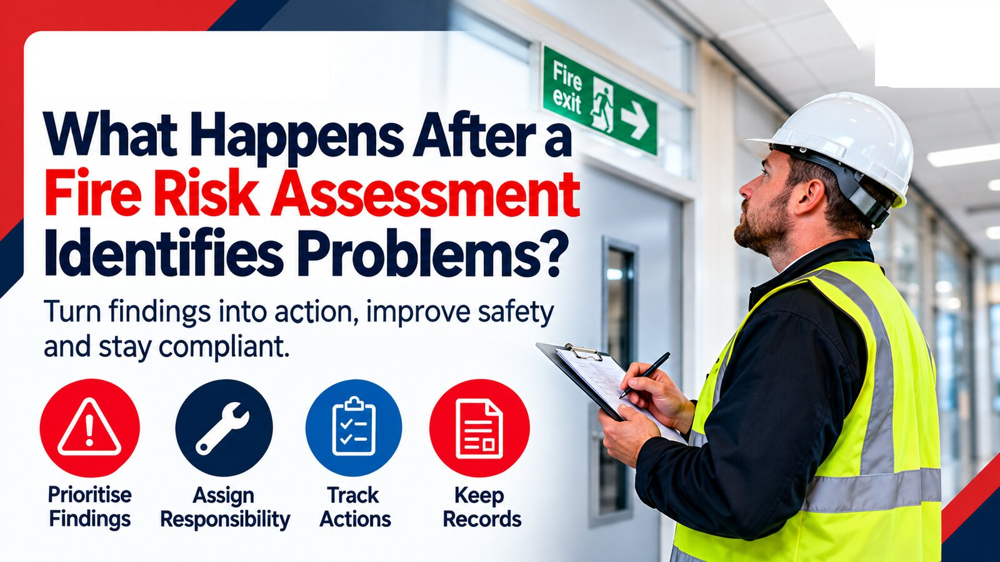

Completing a fire risk assessment is only the first step. What matters next is how quickly and effectively you address the risks identified in the report. The right corrective actions carried out in the correct priority will see the fire risk assessment report work to your advantage as proof of control, supported by a fire risk assessment action plan.

## Which Fire Risk Assessment Findings Should Be Prioritised?

Although there is likely to be a categorisation of either high, medium, or low-risk areas in almost all reports from a fire risk assessment, the terms used by different assessors vary; hence, it is advisable to note how the terms have been defined in the particular report. Findings that hinder any access to the emergency exits and/or the sounding of the alarm must receive an interim response immediately, following the fire risk assessment recommendations.

## Who Should Be Fixing Things?

Under the Regulatory Reform (Fire Safety) Order 2005, the legal obligation lies with the responsible person, which would be the employer or whoever is in control of the premises. The landlord, freeholder or managing agent would be the responsible person if it is in a joint building, but the appointment of a contractor does not shift this responsibility for fire safety remedial works or fire risk assessment corrective actions.

## How Do You Ensure An Action Is Followed Through?

Ensure each finding has a status of awaiting survey, awaiting quote, in progress or completed, along with an identified owner and a target date. Fire stopping, [fire door inspection](/services/fire-door-inspection) and compartmentation issues usually require a specialist survey initially since non-specific advice leads to quotations that are impossible to compare.

## What Information Should Be Stored?

Since 1 October 2023, all persons who are responsible for the business in England and Wales are obliged to keep a record of each assessment or review, regardless of the size of the enterprise. Include pictures, certificates, and invoices for each repair and the closing date of each repair, including records of [fire alarm testing](/services/fire-alarm-testing) and [emergency light testing](/services/emergency-light-testing).

If you are unsure what a compliant testing routine looks like, our guides to [how often a commercial fire alarm should be tested and serviced](/how-often-is-a-commercial-fire-alarm-tested-serviced) and [how often commercial fire extinguishers need servicing or replacing](/how-often-fire-extinguishers-need-servicing) set out the intervals in detail.

## When Should The Risk Assessment Be Reviewed Again?

There is no fixed legal interval for reviewing a fire risk assessment. It should be reviewed regularly and whenever significant changes occur. An annual review is considered good practice for many premises. The triggers are largely the same as the signs that your [fire risk assessment is out of date](/what-happens-if-your-fire-risk-assessment-is-out-of-date), so it pays to know them in advance.

## Who Might Assist In Completing This Task?

Risk Assessment North has been working in fire safety and regulation for over 25 years. Based in Manchester and operating across the North West, the company carries out professional [fire risk assessments](/services/fire-risk-assessment) alongside fire door surveys, emergency light testing, alarm testing, and extinguisher servicing, including [fire risk assessments in Blackpool](/fire-risk-assessments-blackpool) and [fire risk assessments in Preston](/fire-risk-assessments-preston).

If you have not yet appointed an assessor, our guide to the [questions to ask before hiring a fire safety company](/questions-to-ask-before-hiring-fire-safety-company) will help you separate a competent provider from an expensive liability.

<BlogCTA label="Request a Fire Risk Assessment Quote" href="/get-a-quote" />
